<div align="center">

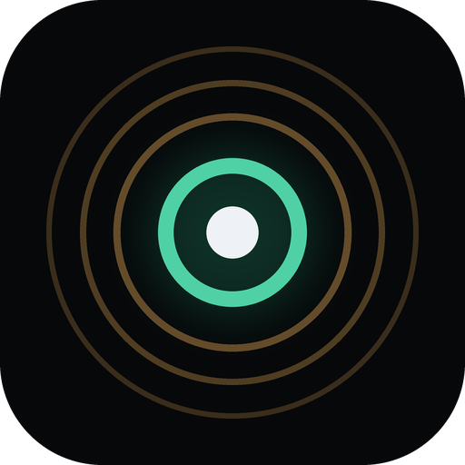

# VoiceLock

<h3>Turn down the world without disconnecting from it.</h3>

<p>Live selective hearing for people who get overwhelmed in loud places.<br>
Pick the voice you want, turn the rest of the room down, and get calm help with one press.</p>

<p>
<a href="docs/media/VoiceLock_demo.mp4"></a>
&nbsp;
<a href="docs/RESEARCH.md"></a>
</p>

<p>


</p>

<a href="docs/media/VoiceLock_demo.mp4">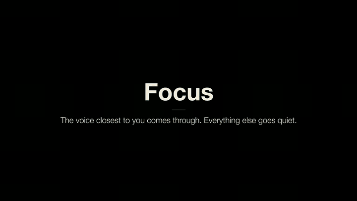</a>

<sub>
<a href="#the-problem">Problem</a> &nbsp;·&nbsp;
<a href="#what-it-does">What it does</a> &nbsp;·&nbsp;
<a href="#screenshots">Screenshots</a> &nbsp;·&nbsp;
<a href="#how-it-works">How it works</a> &nbsp;·&nbsp;
<a href="#results">Results</a> &nbsp;·&nbsp;
<a href="#run-it">Run it</a> &nbsp;·&nbsp;
<a href="#team">Team</a>
</sub>

</div>

<br>

## The problem

Some of the people closest to us are autistic. We've seen how overwhelming an everyday place gets when many conversations happen at once: a café, a conference hall, a hackathon like this one. For many autistic people with sensory overload, a room like that is off-limits, and staying home is easier.

Noise cancelling turns everyone off, including the one person you came to talk to. We wanted the opposite: let someone choose what they hear, and remember what helps them when it's still too much.

## What it does

VoiceLock is a web app you install on your phone. You listen through your earbuds (AirPods Pro in our demo).

1. **Focus on one voice.** VoiceLock cleans the café noise out of the room, splits what's left into separate voices, and plays the loudest, closest one: the person talking to you. Everyone else is left out, at one steady volume. Press Space or flip the switch to hear the whole room again.
2. **Go quiet and read instead.** When even one voice is too much, Quiet mode pauses the audio and the person's words keep coming as captions (ElevenLabs speech-to-text), so you stay in the conversation.
3. **One press for SOS.** One press cuts the room and fades in your favourite calm sound. Then you choose: Stay Quiet (silence plus captions), Play My Sounds (rain, brown or white noise, a soft pad) or Talk to Me.
4. **Talk to Me.** A calm spoken companion. Hold to talk or type, and it answers out loud. Gemini writes the reply from your saved profile (what helps, what to avoid) and ElevenLabs speaks it. It offers to remember what helped and saves it only when you confirm. Ask it to "call Jordan" and it opens a call to your saved person: the real dialer on a phone, a labelled demo call screen on the laptop.
5. **See what it learned.** "What I've learned about you" shows your profile in plain words. Open it, change it, remove anything.

There's also a phone companion you open by scanning a QR code, a one-button presenter remote that stands in for the wearable band we want to build, and a separate Who's speaking page that shows our fine-tuned speaker recognition telling two teammates apart live.

VoiceLock is support for sensory overload, not treatment or medical advice. It never guesses how you feel; you press the button. If someone mentions being in danger, Talk to Me points them to the 988 Suicide and Crisis Lifeline (or 911) instead of giving advice.

## Screenshots

| Welcome | Listen |
|---|---|
| 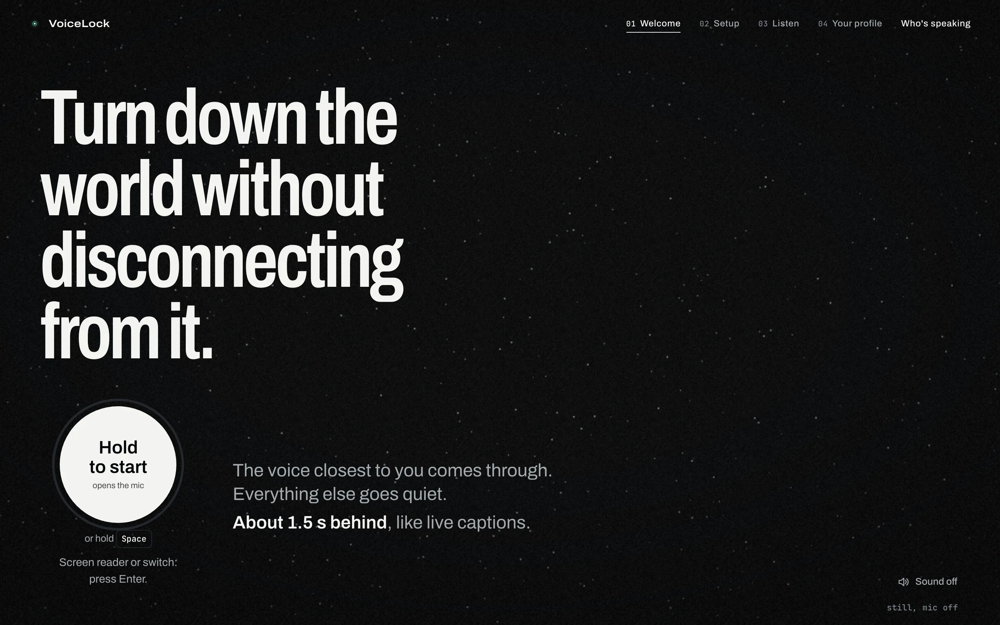 | 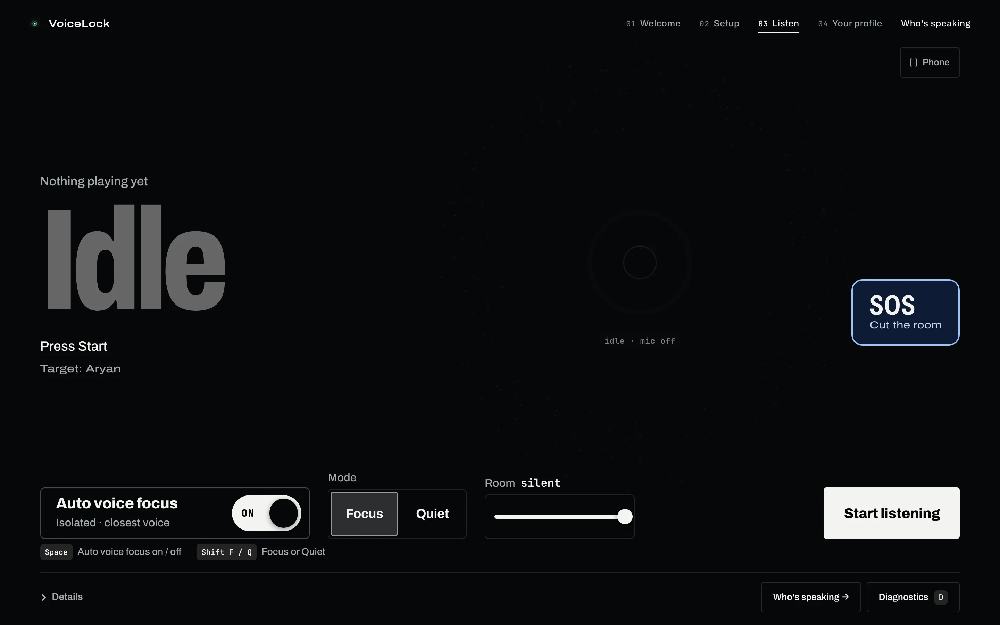 |
| **SOS: what would help?** | **Talk to Me** |
| 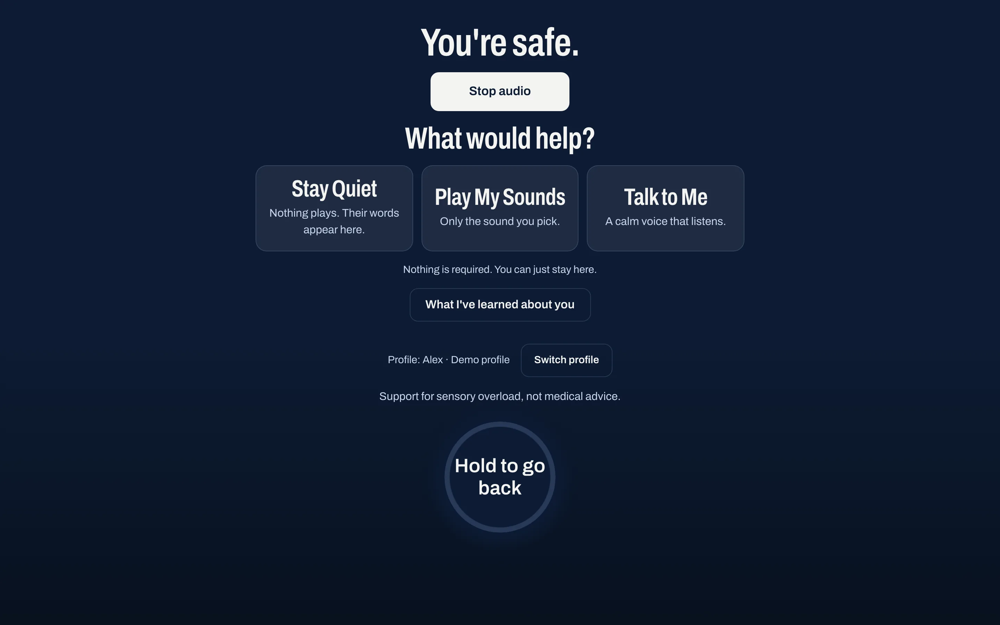 | 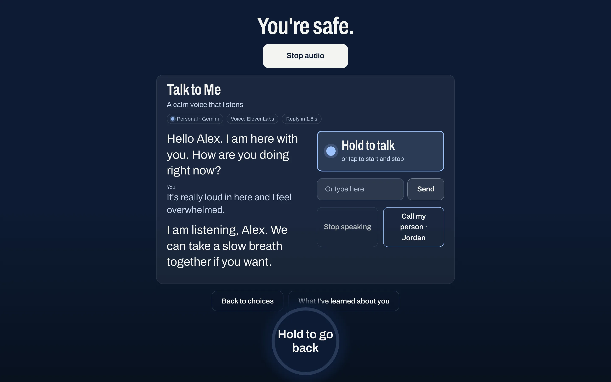 |
| **What I've learned about you** | **Who's speaking** |
| 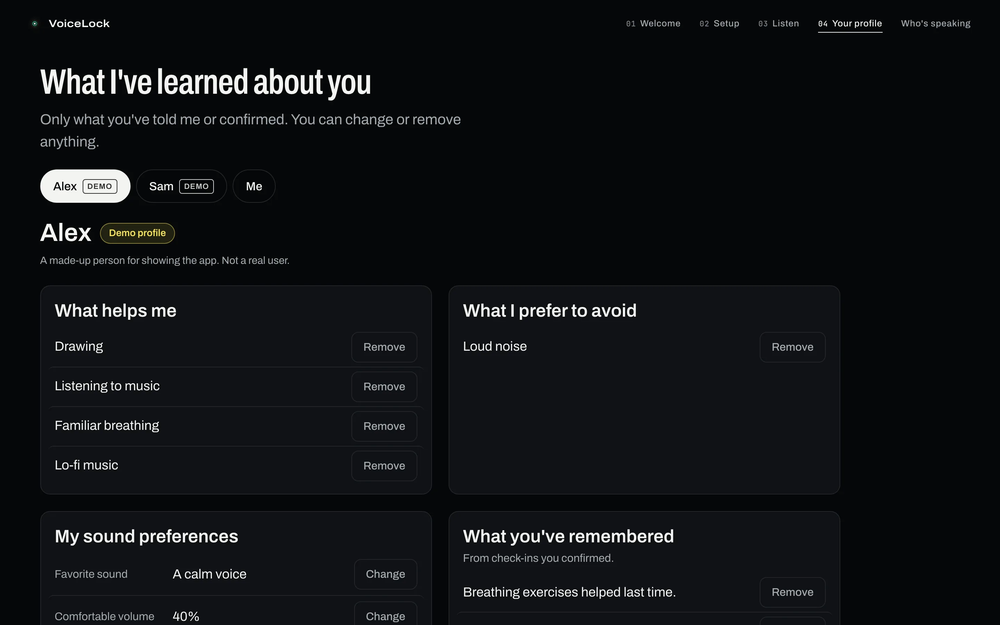 | 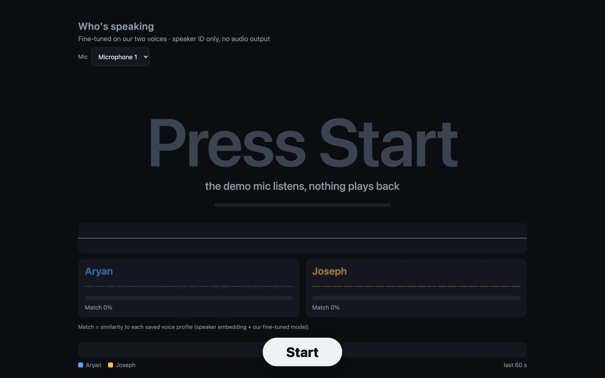 |
| **Phone companion** | |
| 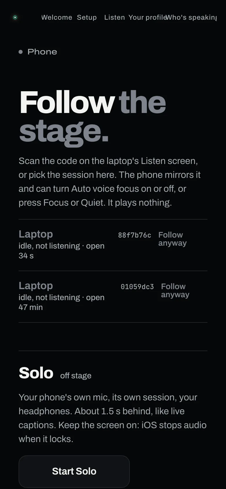 | |

<sub>Screenshots of the running app. The profile shown is Alex, a made-up demo profile. The Talk to Me reply came from the live Gemini and ElevenLabs path.</sub>

The demo video labels what is live and what is recorded: the before/after café clip was recorded earlier and processed by VoiceLock, the Listen screen's mic input is a pre-recorded test voice, and Who's speaking runs on recorded clips of Aryan, then Joseph. The SOS, Talk to Me and profile screens are the live app.

## How it works

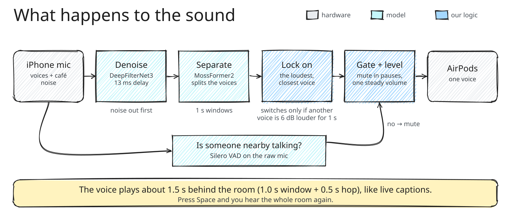

A Python server (FastAPI) takes microphone audio over a WebSocket, runs it through a PyTorch pipeline, and streams the chosen voice back to the web app.

1. **Denoise first.** DeepFilterNet3, low-latency variant, 13 ms of algorithmic delay. We tested both orders and denoising before separation won on every count.
2. **Separate.** A pretrained MossFormer2 splits each 1 s window into separate voice streams.
3. **Lock on.** Focus plays the loudest stream. Another voice takes over only when it's 6 dB louder for a full second, so the lock doesn't flicker and short pauses don't break it.
4. **Gate and level.** A Silero VAD gate on the raw mic mutes the output when nobody nearby is talking, and a steady output gain keeps the voice at one level.

The output plays about 1.5 s behind the room (1.0 s window plus 0.5 s hop), like live captions.

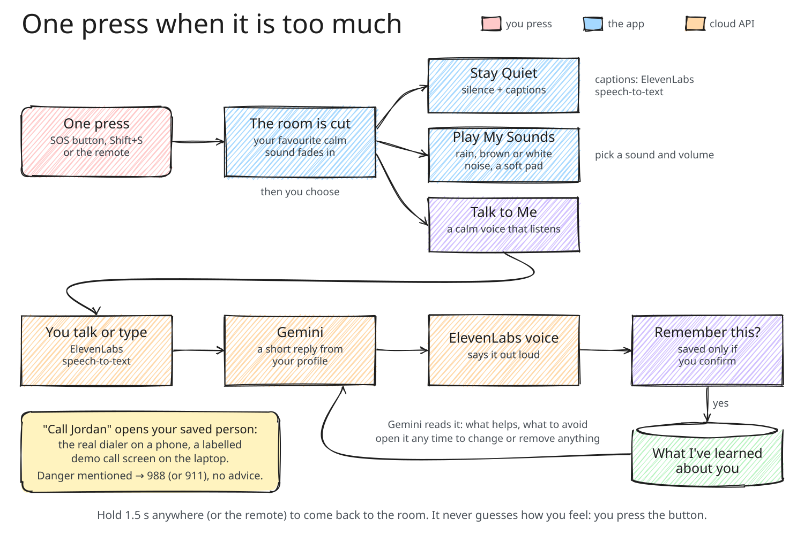

Talk to Me sends Gemini the profile, what the user has confirmed helps, and what to avoid. Gemini returns a short reply as schema-constrained JSON, plus whether to offer a "Remember this?" chip or start a call. ElevenLabs handles the voice and the captions. Every outside service sits behind an adapter with an offline fallback: without a key or a connection, Talk to Me gives a gentle default reply and the screen says so.

We also fine-tuned MossFormer2 on our own voices on Rutgers iLab A100 GPUs, with a fixed output order (slot 0 is always one teammate, slot 1 the other). That model powers the Who's speaking page.

## Results

Every number below was measured with its condition written down. The full list, and what went wrong along the way, is in [docs/RESEARCH.md](docs/RESEARCH.md).

| What | Result | Condition |
|---|---|---|
| Correct-speaker selection | 99.2% | profile mode, 2 s voice sample, 120 equal-loudness two-speaker mixtures |
| Separation quality | +17.6 dB SI-SDRi | recorded clip, two team voices at equal loudness plus real café noise; the other voice 52 dB down while only they talk |
| Across our four voices | +8.1 to +14.3 dB SI-SDRi | all six pairs, offline, including a competing voice 6 dB louder and café noise |
| Fine-tuning on familiar voices | 31.6% → 4.5% wrong-speaker time | offline, 14 held-out team rows |
| Who's speaking | 100% correct labels (311/311, 307/307 windows) | held-out MacBook-mic recordings; median 0.5 s to switch speakers |

The fine-tuned separator does well on our voices and badly on strangers (62 to 93% wrong-speaker time on voices it never heard), so the live app ships the general model.

## Run it

Needs macOS or Linux, Python 3.11+, `ffmpeg` and `libsndfile`.

```bash
git clone https://github.com/aryanpatel142006/VoiceLock.git
cd VoiceLock
bash scripts/setup.sh                        # creates .venv and installs the package
.venv/bin/pip install -e ".[ml,eval]"        # the model stack: PyTorch, ONNX Runtime, SpeechBrain, Silero VAD, faster-whisper
.venv/bin/pip install --no-deps clearvoice   # MossFormer2; it pins numpy<2, so install it without deps (see pyproject.toml)

# optional: Talk to Me and captions (without keys it falls back to a gentle default and says so)
export GEMINI_API_KEY=...  ELEVENLABS_API_KEY=...

# start the demo: opens https://localhost:8000/app/ (self-signed certificate);
# phones on the same Wi-Fi get a QR code for the companion
HEARING_COMFORT=1 HEARING_PICK=loudest bash scripts/demo.sh --judge --team --lan --app
```

- `--mic "<label>"` picks the input device by its exact name (we use an iPhone cabled to the laptop).
- `--port 0` picks a free port and prints it, `--no-open` skips the browser, and `bash scripts/demo.sh --stop --port <port>` stops the server.
- `--team` loads the two-voice preset in `config/demo-team.yaml`, which expects saved voice profiles (`scripts/enroll_profiles.sh`).
- In the app, Space turns Auto voice focus on or off, Shift+F and Shift+Q switch between Focus and Quiet, and Shift+S (or a paired presenter remote) is SOS. Hold for 1.5 s to come back to the room.
- The Who's speaking page is at `/who` and the stage console at `/judge`.

Model weights download on first use and are not in this repository. Neither are voice recordings, voice profiles or our fine-tuned checkpoints, because those encode our teammates' voices. More detail in [docs/DEMO.md](docs/DEMO.md), [docs/APP.md](docs/APP.md), [docs/MODELS.md](docs/MODELS.md) and [docs/STAGE_CARD.md](docs/STAGE_CARD.md).

## Tech stack

| | |
|---|---|
| **App** | HTML, CSS and JavaScript, installable as a PWA; WebSockets |
| **Server** | Python, FastAPI, PyTorch |
| **Audio models** | DeepFilterNet3 (denoise), MossFormer2 (separation, fine-tuned on Rutgers iLab A100 GPUs), ECAPA speaker embeddings, Silero VAD |
| **Talk to Me** | Gemini (schema-constrained JSON), ElevenLabs text-to-speech and speech-to-text |
| **Demo hardware** | A MacBook, an iPhone cabled to it as the mic, AirPods Pro, a presenter remote |
| **How we worked** | Claude Code, Codex and Gemini agents coordinated through a Notion board and GitHub |

## Project structure

```
VoiceLock/
├── hearing/          the Python engine
│   ├── audio/        mic input, output and level control
│   ├── enhance/      DeepFilterNet3 denoise and the foreground-speech gate
│   ├── tse/          separation and picking the target voice
│   ├── fusion/       mixing, gating and voice-activity logic
│   ├── context/      saved sound preferences
│   ├── synth/        speech-to-text and text-to-speech adapters
│   ├── server/       FastAPI + WebSocket session server, SOS/Comfort, Who's speaking
│   └── vision/       face and lip tracking (console only; the demo is audio-only)
├── web/
│   ├── app/          the PWA: Welcome, Listen, SOS, Talk to Me, profile, phone companion
│   └── console/      the stage console (/judge) and the Who's speaking page (/who)
├── config/           demo presets and tier settings
├── scripts/          setup, demo launcher, voice-profile enrollment, GPU launcher
├── tools/            evaluation statistics (paired_stats.py)
├── research/         two research write-ups
├── third_party/      small borrowed source files with their licences
└── docs/             demo runbook, app guide, models, benchmarks, research notes, media
```

This repository holds the demo app. Tests, benchmark tooling and training experiments live in our working repository.

## Team

Built at **HackRU Fall 2026** by Aryan Patel, Joseph Roche and Ahmad Abbadi.

Three of us coordinated a group of AI coding agents through a Notion task board and GitHub. Each agent took a task, worked in its own git worktree and reported measured numbers; we reviewed and merged. Every live session was recorded, so our numbers come from recordings.

> VoiceLock was a hackathon project. It is support for sensory overload and not a medical device.
