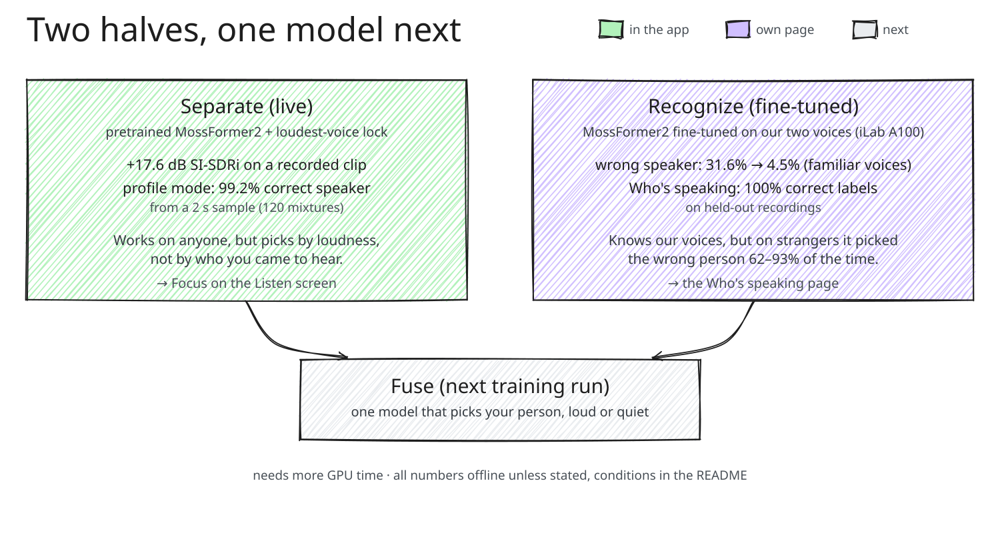

# Research notes

What we measured while building VoiceLock at HackRU Fall 2026, what went wrong, and what we would do next. The app itself is described in the [README](../README.md); every benchmark row with its exact condition is in [BENCHMARKS.md](BENCHMARKS.md).

## The model behind each step

The microphone hears a mixture of voices and noise:

$$x(t) = \sum_{i=1}^{N} s_i(t) + n(t)$$

1. **Denoise.** DeepFilterNet3 (low-latency variant, 13 ms algorithmic delay) removes the café noise $n(t)$ before separation. We measured both orders offline and denoising first won on every count. Run after separation, the denoiser treated separation artifacts as noise and clipped words after a pause.
2. **Separate.** A pretrained MossFormer2 separator splits each 1 s window into streams $\hat s_1, \dots, \hat s_K$.
3. **Select.** Live Focus, the mode we demo, plays the loudest stream:
   $$k^* = \arg\max_k \lVert \hat s_k \rVert^2$$
   Another voice takes over only when it is 6 dB louder for a full second, so the lock doesn't flicker and short pauses don't break it.
   Profile mode, our research path, picks the stream that sounds most like a saved voice sample, using ECAPA speaker embeddings $e(\cdot)$:
   $$k^* = \arg\max_k \cos\big(e(\hat s_k),\, e_{\text{target}}\big)$$
4. **Gate and level.** A Silero VAD foreground-speech gate, run on the raw input, mutes the output when nobody nearby is talking, so café babble doesn't leak through in pauses. A steady output gain keeps the voice at one level.

The output plays about 1.5 s behind the room (1.0 s window plus 0.5 s hop).

## What we measured

- 99.2% correct-speaker selection in profile mode, from a 2 s voice sample, on a benchmark of 120 equal-loudness two-speaker mixtures (frozen speaker encoder).
- +17.6 dB SI-SDR improvement, with the other voice 52 dB down while only they talk, on a recorded clip: two team voices at equal loudness with real café noise, processed afterwards.
- +8.1 to +14.3 dB SI-SDRi in profile mode across all six pairs of our four recorded voices (offline mixtures, including a competing voice 6 dB louder and café noise).
- 7× fewer wrong-speaker mistakes for familiar voices after fine-tuning (31.6% to 4.5%, offline).
- Who's speaking: 100% correct labels on held-out MacBook-mic recordings (311/311 and 307/307 windows), switching to the new speaker in a median of 0.5 s.
- Focus, Quiet, SOS, Talk to Me, a learned profile and a phone companion all run end to end, live, on a laptop.

Improvement is measured in decibels with the scale-invariant signal-to-distortion ratio:

$$\text{SI-SDR}(\hat s, s) = 10\log_{10}\frac{\lVert \alpha s\rVert^2}{\lVert \alpha s - \hat s\rVert^2}, \qquad \alpha = \frac{\langle \hat s, s\rangle}{\lVert s\rVert^2}$$

$$\text{SI-SDRi} = \text{SI-SDR}(\hat s, s) - \text{SI-SDR}(x, s)$$

That is how much closer the output $\hat s$ is to the clean voice $s$ than the raw mixture $x$ was. Every number above was measured with its condition written down. We'd rather show a real 4.5% than an impressive guess.

## What was hard

**A quiet voice under a louder one.** Today's models separate two voices well. Picking the right one when it's quieter than its neighbour is much harder, and that's the case that matters most to our users. Similar voices make it worse. Offline, with only 2 s of calibration, the wrong person came through 1.0% of the overlap time for male/female pairs and 9.1% for male/male pairs.

**A smaller, faster model.** We tried distilling the separator into a smaller streaming student, but in our time budget the student didn't learn enough to replace the teacher.

**Fine-tuning helps with familiar voices and hurts with strangers.** Fine-tuned on two teammates, wrong-speaker time fell from 31.6% with the stock model to 4.5% (offline, 14 held-out team rows). On voices it had never heard, the same models picked the wrong person 62 to 93% of the time. Our users will meet strangers, so the app ships the general model. The fine-tuned model lives on the Who's speaking page.

**A learned projection head made things worse.** We added a small learned layer on top of the speaker embeddings to sharpen the match. On synthetic test embeddings it accepted the wrong voice in 52% of windows where the target wasn't speaking (plain cosine: 0%), so we kept the simpler scorer.

**The real world.** Our first live test, at 4 a.m. on judging day, went badly, and the recordings showed why:

- Voice profiles recorded on the MacBook mic didn't match the iPhone mic we used on stage. Similarity dropped from 0.52 to 0.55 down to 0.32 to 0.35, and the system muted the target speaker for 69 to 92% of the time it was locked on. That is why live Focus now follows the loudest, closest voice instead of a profile.
- The output volume pumped by about 28 dB, many times a minute. We replaced it with a steady output gain and the VAD gate.
- Agent jobs on the same Mac overloaded the pipeline, so demos now run on an idle machine.
- The AirPods mic forces call-quality Bluetooth audio, so the mic is an iPhone cabled to the laptop. Bluetooth playback adds a delay we haven't measured on top of the 1.5 s.
- Café noise landed in whichever voice was picked, which led to denoise-first and the VAD gate.
- macOS Python's default TLS context failed every Gemini and ElevenLabs call with `CERTIFICATE_VERIFY_FAILED` until we pointed it at a proper certificate bundle.

## What we learned

- Several ideas that looked good on paper (a projection head, stricter voice matching, more enrollment examples) didn't survive measurement. The recordings told us more than our intuitions did.
- A model can score well on clean mixtures and still fail on a different microphone in a noisy room. We learned to test on the hardware we'd demo on.
- Denoising before separation fixed problems that no amount of tuning afterwards could.
- The features that matter most (one press to make it stop, a calm voice, captions instead of sound) came from asking what someone overwhelmed actually needs.
- Coordinating many AI coding agents needs clear tasks, isolated workspaces and honest reports.

## What's next

- One model that both separates and recognizes, picking your person whether they are loud or quiet. That needs a fresh training run with more GPU time.
- Quieter voices in louder rooms, and detecting when your person isn't talking at all.
- Lower latency: on-device processing on the phone, and wired audio instead of Bluetooth.
- A wearable band with one press on the wrist, replacing today's presenter remote.
- Testing with autistic users and their families, in real places.
