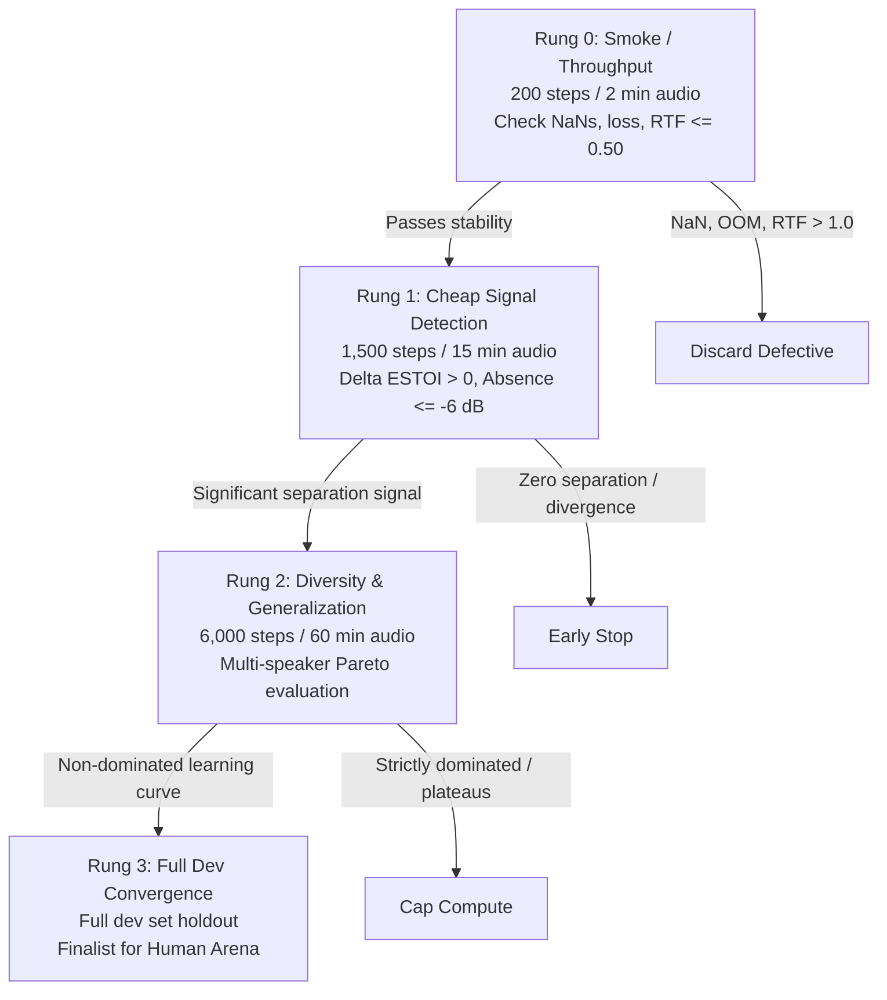

# Proven Perceptual Arena Metrics, Progressive Scheduling, Mono Streaming TSE & GPU Unblocking (Q831)

**Author:** Gemini (`antigravity-b`)  
**Target:** Muse (`muse-b` / `muse-c`), Joseph, Aryan, and Root Orchestrator  
**Date:** October 10, 2026  
**Status:** Actionable Primary-Source Technical Brief & GPU Operational Unblocking  
**Output Files:**  
- `/Users/joeroche/.local/state/selective-hearing-arena/20261010/GEMINI_RESEARCH.md`
- `docs/research/ARENA_EXPERIMENT_SELECTION.md`

---

## Executive Summary & Non-Interference Context

1. **Context & Non-Interference:**
   Per Joseph's directive, Gemini conducts this research brief in parallel with Arena engineering (`experiments/arena`). Active Slurm Job 447101 on the Rutgers iLab RTX A4500 (`ilab1`) is actively processing resident public noise/absence evaluations (`100 public take0`, `200 team AGC comparison`, `300 public take1`, `400 public take2`). This research does not interrupt or delay running tests, makes no autonomous deployments, and provides actionable primary-source methods to guide subsequent experiment selection.
2. **GPU Proposals Q831 Status:**
   Proposals `task/R36` and `distill-student` are currently cloud-local / uncommitted (`git ls-remote origin task/R36` is absent; scripts reference unmounted cloud paths). Under swarm rules, missing packages must be marked **`BLOCKED`**, never **`Ready`**. A concrete deliverable checklist is detailed below to allow Muse to unblock them.

---

## Recommendation 1: Decoupled Multi-Dimensional Metric Stack (No Composite Leaderboard)

Optimization must never collapse into a single composite score or artificial leaderboard formula (e.g. $S = 0.3 \cdot \text{ESTOI} + 0.3 \cdot \text{DNSMOS} + \dots$). In selective hearing, weighting hides critical failure modes: an aggressive model can achieve decent ASR WER by brute-force spectral subtraction while sounding harshly metallic, or a model can score high on DNSMOS naturalness while leaking 25% of the interfering speaker.

### 1. The 4-Dimensional Metric Hierarchy

| Dimension | Primary Metric & Tool | Reference Requirement | Failure Mode / Caveats | Human Perceptual Question |
|---|---|---|---|---|
| **Target Intelligibility** | **ESTOI** (Jensen & Taal, 2016; `pystoi` / `torchmetrics`) + **Target-Only ASR WER** (Whisper-base/small) | **Aligned clean target speech** required for ESTOI; **clean target text transcript** for WER. | Aggressive Wiener gain clipping or non-linear phase butcher inflates ESTOI/WER but causes severe "vocoder fatigue" and robotic metallic timbre. Hallucinations on distorted audio must be penalized. | *Can I understand every word effortlessly?* |
| **Target Isolation & Absence** | **Target-Absent Attenuation ($\Delta L_{\text{absent}}$)** in dB; **$\Delta\text{SI-SDR}$** (Le Roux et al., 2019) on active speech | **Reference-free for absence** (ground-truth target is 0); **aligned clean target** for active $\Delta\text{SI-SDR}$. | **Critical:** During target-absent windows, SI-SDR has a zero denominator. Do NOT evaluate SI-SDR against silence or report mathematical infinities; evaluate attenuation relative to input mixture ($10\log_{10} \frac{\|y_{\text{out}}\|^2}{\|x_{\text{mix}}\|^2}$). | *Do I hear the wrong person when they speak or when the target pauses?* |
| **Naturalness & Artifacts** | **DNSMOS P.835** (`OVRL`, `SIG`, `BAK`; Reddy et al., Microsoft DNS Challenge 2021/2022); auxiliary **PESQ P.862.2 / ViSQOL** | **Reference-free (non-intrusive)** for DNSMOS; **aligned clean target** for PESQ/ViSQOL. | Essential for real-mic and in-the-wild teammate recordings where clean stems do not exist. Directly penalizes robotic distortion, watery musical noise, and clipping artifacts. | *Does the voice sound human or robotic?* |
| **Streaming Responsiveness** | **p95 / p99 Chunk Processing Latency** (ms per 10 ms hop); **Real-Time Factor ($\text{RTF}_{p95}$)**; **Dropouts / underruns** | **Analytic / System Telemetry** (no reference required). | Algorithmic lookahead latency ($L_{\text{algo}}$) must be tracked strictly separately from compute latency. Compute exceeding the 10 ms hop triggers buffer underruns and fallback. Hard constraint: $\text{RTF}_{p95} \le 0.30$. | *Does the interaction feel instantaneous and glitch-free?* |

### 2. Mathematics of Absence Attenuation & Target Active Metrics
- **Target-Absent Attenuation ($\Delta L_{\text{absent}}$):**
  $$\Delta L_{\text{absent}} = 10 \log_{10} \left( \frac{\sum_{t \in \mathcal{T}_{\text{absent}}} y_{\text{out}}[t]^2 + \epsilon}{\sum_{t \in \mathcal{T}_{\text{absent}}} x_{\text{mix}}[t]^2 + \epsilon} \right)$$
  Acceptance threshold: $\Delta L_{\text{absent}} \le -12.0\text{ dB}$, with other-speaker dominant frames $\le 5\%$.
- **Active Speech Separation ($\Delta\text{SI-SDR}$):**
  $$\text{SI-SDR}(s, \hat{s}) = 10 \log_{10} \frac{\|\alpha s\|^2}{\|\alpha s - \hat{s}\|^2}, \quad \alpha = \frac{\langle \hat{s}, s \rangle}{\|s\|^2}$$
  $$\Delta\text{SI-SDR} = \text{SI-SDR}(s, y_{\text{out}}) - \text{SI-SDR}(s, x_{\text{mix}})$$
  Evaluated strictly over frames where target voice activity detector (VAD) is active.

### 3. Pareto Frontier Selection Rule
- Candidates are characterized by the 4D vector $\mathbf{m} = (\text{ESTOI}, -\Delta L_{\text{absent}}, \text{DNSMOS\_OVRL}, -\text{RTF})$.
- **Strict Pareto Dominance:** Candidate $B$ is discarded *if and only if* Candidate $A$ is equal or better on all four metrics and strictly better on at least one:
  $$A \succ_{\text{Pareto}} B \iff (\forall i, m_{A,i} \ge m_{B,i}) \land (\exists j, m_{A,j} > m_{B,j})$$
- All non-dominated candidates (e.g., Model A with higher ESTOI but slightly lower DNSMOS vs. Model B with higher DNSMOS and slightly lower SI-SDR) are preserved for the Arena.

---

## Recommendation 2: Progressive Asynchronous Compute Allocation (ASHA Ladder)

Compute budgets must not be allocated uniformly or based on static 50/200/500 speaker requirements. Compute is allocated progressively via **asynchronous successive halving**, stopping defective models early and allocating more GPU hours only when empirical learning curves justify it.



### 1. Fixed Dev / Final Split Integrity
- **Strict Isolation:** In accordance with `experiments/arena/core.py`, there must be **zero intersection** of `recording_ids`, `speaker_ids`, and `session_ids` between the development split and the locked final evaluation set.
- **Development Set:** Open public corpora (Libri2Mix, VoxCeleb, ESC-50, OpenSLR 28 RIRs).
- **Locked Final Test Set:** Teammate binaural and real room recordings. Hyperparameter sweeps and early-stopping criteria must never touch the locked final set.

### 2. Units of Budget Allocation
- **Extraction Models:** Measured in **audio minutes** or **optimizer training steps** (not speaker count alone, as utterance duration varies widely).
- **Distillation Models:** Measured in **paired embeddings** and **speaker diversity count**.

### 3. Simple Implementable Promotion Rules
- **Rung 0 (Sanity, ~200 steps / 2 min):**
  - Criteria: Gradients finite (no NaN/Inf), training loss monotonically decreasing over last 50 steps, peak VRAM within hardware safety limit ($< 18\text{ GB}$ on RTX A4500), $\text{RTF} \le 0.50$.
  - Action: Discard immediately on failure; promote on pass.
- **Rung 1 (Signal Detection, ~1,500 steps / 15 min):**
  - Criteria: $\Delta\text{ESTOI} > 0.0$ and target-absent attenuation $\Delta L_{\text{absent}} \le -6.0\text{ dB}$ on dev holdout slice.
  - Action: Early-stop if model shows zero separation gain; promote if positive delta observed.
- **Rung 2 (Speaker Diversity & Generalization, ~6,000 steps / 60 min):**
  - Criteria: Multi-speaker dev mixtures (including same-gender pairs). Candidate must lie on the empirical Pareto frontier relative to baseline.
  - Action: Cap compute if training loss decreases but validation isolation plateaus; promote if learning curve is active.
- **Rung 3 (Full Dev Convergence, full dev allocation):**
  - Criteria: Fully trained checkpoint evaluated on full dev holdout. Candidates that remain non-dominated qualify for the 5-minute Human Listening Arena.

### 4. Grouped Paired-Bootstrap Uncertainty Estimation
- **The Grouping Principle:** Adjacent 0.5 s audio frames within an audio recording are strongly autocorrelated. Treating them as independent observations artificially shrinks confidence intervals by $5\times\text{–}10\times$.
- **Resampling Method:** Group samples by **independent Speaker Pair** or **Recording Session ID**.
  Perform $B = 2,000$ paired bootstrap draws:
  $$\Delta^{(b)} = \frac{1}{K} \sum_{k=1}^K \left( \bar{x}_{A, k}^{(b)} - \bar{x}_{B, k}^{(b)} \right)$$
  where $k$ indexes the independent cluster/session.
- **Pruning Rule:** Discard a model only if the baseline is statistically superior with 95% confidence (i.e. the 95% bootstrap CI $[\Delta_{2.5\%}, \Delta_{97.5\%}]$ excludes zero in favor of baseline across all objectives). If the confidence interval includes zero, the model is **statistically uncertain** and MUST be retained.

---

## Recommendation 3: Five-Minute Blind Listening Arena Session

Human listening is the irreplaceable perceptual ground truth. The Arena (`experiments/arena`) is structured to provide decisive evaluations in 5 minutes without fatiguing engineers.

### 1. High-Information Comparison Selection
- Do not present random or easily decided comparisons to the human listener.
- The automated scheduler populates the listening queue with **10–20 high-information matchups**:
  1. Candidates on the non-dominated Pareto frontier where objective metrics conflict (e.g., Model A has +0.07 higher ESTOI but -0.35 lower DNSMOS OVRL than Model B).
  2. Candidate pairs where paired bootstrap 95% confidence intervals cross zero (maximum objective uncertainty).

### 2. Synchronized Pre-Rendered Playback Architecture
- **Pre-Rendering:** Candidate outputs are pre-rendered, verified, and indexed by SHA-256 content hashes (`file_hash`). Inference is never run during listening.
- **Seamless A/B Switching:** The web interface (`AudioContext`) toggles between Stream A and Stream B at the exact same sub-millisecond timestamp with a **5 ms equal-power crossfade**. This eliminates playback restart, click transients, and loss of auditory focus.

### 3. Loudness Gain Caps & Psychoacoustic Normalization
- **Volume Bias (Fletcher-Munson):** Audio that is even $1.0\text{ dB}$ louder is consistently judged as clearer and more natural by human listeners.
- **BS.1770-4 Normalization:** All comparison stems are loudness-normalized to **$-23.0\text{ LUFS}$** using `pyloudnorm`.
- **Strict Gain Adjustment Caps:** Loudness adjustments are strictly clamped to **$[\pm 6.0\text{ dB}]$**, with a true-peak ceiling at **$-1.0\text{ dBTP}$**.
- *Protection against Failure Boosting:* If a model produces near-silence during target-absent windows, gain clamping prevents boosting the residual background noise floor into loud $-23\text{ LUFS}$ hiss.

### 4. Four-Way Decision Contract & Persistent Provenance
- **Verdict Schema:** Matching `experiments/arena/core.py`:
  - `'a'`: Candidate A is clearly superior.
  - `'b'`: Candidate B is clearly superior.
  - `'tie'`: Indistinguishable or equivalent quality.
  - `'neither'`: Both candidates are unusable (e.g., both sound corrupted or fail basic product quality).
- **Persistent Provenance:** Every verdict is durably appended with `fsync` to `verdicts.jsonl`, storing:
  - `scenario_id`, `recording_id`, `candidate_ids`, `seed`
  - `checkpoint_hashes` (SHA-256 of candidate weights)
  - `config_provenance` (SHA-256 of candidate configurations)
  - `client_verdict_id` (idempotency key)
  - `outcome` and optional `reason`

### 5. Calibrated Regularized Preference Modeling
- **Cold-Start Policy:** Do NOT fit a preference model until $\ge 30\text{–}40$ distinct human judgments have been collected.
- **Formulation:** Fit an $L_2$-regularized Bradley-Terry logistic model on objective feature differences:
  $$P(A \succ B) = \sigma\left(\mathbf{w}^\top (\mathbf{x}_A - \mathbf{x}_B)\right)$$
  where $\mathbf{x} = [\Delta\text{ESTOI}, \Delta\text{DNSMOS\_OVRL}, \Delta L_{\text{absent}}, \Delta\text{RTF}]^\top$.
- **Validation:** Evaluate log-loss and ranking accuracy via leave-one-session-out cross-validation.
- **Active Learning:** Query the human listener on pairs where predicted preference is most uncertain ($P(A \succ B) \approx 0.50$).
- **Deployment Constraint:** The preference model is an active sampler for the Arena; it is NEVER permitted to autonomously deploy models to production.

---

## Recommendation 4: Mono Streaming Target-Speaker Extraction (TSE) Candidates

### 1. Distinction: Causal Framewise Streaming vs. Offline Model Windowing

| Property | Offline Model Windowing (e.g. ClearerVoice, SepFormer, SoloSpeech) | Genuine Mono Causal Streaming (e.g. TD-SpeakerBeam, Causal BSRNN) |
|---|---|---|
| **Temporal Context** | Bidirectional self-attention or global temporal pooling. | Causal convolutions (left padding only, $t \le \tau$) or causal attention with recurrent KV-caches. |
| **Algorithmic Latency** | **$1,000\text{–}2,000\text{ ms}$** (window length + lookahead). | **$\le 24\text{–}32\text{ ms}$** (hop size + minimal encoder lookahead). |
| **Buffering Mode** | Sliding windows with overlap-add crossfading. | Frame-by-frame stateful execution across 10 ms hops. |
| **Live Viability** | Unusable for interactive conversations (<100 ms mouth-to-ear budget); suitable only for delayed replay. | Direct integration into `hearing.types.Stage` streaming loop. |

### 2. Genuinely Mono Streaming Candidates

#### Candidate 1: ESPnet2 Time-Domain SpeakerBeam (TD-SpeakerBeam)
- **Primary Citation:** Delcroix et al., *"Improving Time-Domain Target Speaker Extraction with Auxiliary Speaker Identification"*, IEEE/ACM TASLP 2020 ([arXiv:2001.08378](https://arxiv.org/abs/2001.08378)).
- **Official Toolkit / Code:** ESPnet Toolkit ([`espnet/espnet`](https://github.com/espnet/espnet)), Apache-2.0 license.
- **Released Pretrained Checkpoint:** Hosted on Hugging Face: [`wyz/librimix_tse_clean_2mix_training_td_speakerbeam_16k`](https://huggingface.co/wyz/librimix_tse_clean_2mix_training_td_speakerbeam_16k) (Apache-2.0 / CC-BY-4.0 compatible).
- **Causal Architecture:** Dilated Conv1D temporal blocks configured with causal convolution masks (`causal: true`) and cumulative layer normalization (`cLN`). Encoder kernel size 32, stride 16 at 16 kHz = **1.0 ms hop algorithmic latency**.
- **Adapter Integration Shortcut:**
  The adaptation block takes an internal 256-d speaker embedding. Project the team's resident 192-d ECAPA-TDNN embedding into the 256-d bottleneck using a lightweight single linear adapter:
  ```python
  class ECAPAToSpeakerBeamAdapter(nn.Module):
      def __init__(self):
          super().__init__()
          self.proj = nn.Linear(192, 256)
      def forward(self, ecapa_emb):
          return self.proj(ecapa_emb)
  ```
  This requires zero core pipeline modifications and fits directly into `Stage.process(chunk, ctx)`.

#### Candidate 2: WeSep Causal BSRNN / SpEx+ (REAL-TSE Track 1 Online Baseline)
- **Primary Citation:** SLT 2026 REAL-TSE Challenge Overview ([arXiv:2607.15198](https://arxiv.org/abs/2607.15198)); WeSep Toolkit ([arXiv:2607.27436](https://arxiv.org/abs/2607.27436)).
- **Official Toolkit / Code:** WeSep Toolkit ([`wenet-e2e/wesep`](https://github.com/wenet-e2e/wesep)), Apache-2.0 license; Challenge Baseline repo: [`REAL-TSE/REAL-T`](https://github.com/REAL-TSE/REAL-T).
- **Causal Architecture:** Band-Split Recurrent Neural Network (BSRNN) with unidirectional GRU/LSTM recurrent layers and causal STFT masking. Algorithmic latency is strictly **24 ms** (128-sample hop at 16 kHz), fully compliant with SLT 2026 Track 1 online challenge constraints.
- **Conditioning Cue:** Native 192-d WeSpeaker / ECAPA-TDNN speaker embedding.
- **Adapter Integration Shortcut:**
  Wrap the stateful recurrent hidden state in `Stage.reset()` and carry forward hidden tensors across 10 ms chunks.

### 3. Factual Clarification on Other Mentioned Architectures
- **Waveformer (`vb000/Waveformer`, ICASSP 2023):** Real-time target sound extraction (<20 ms latency, 10 ms chunks), open source (Apache-2.0), code and pretrained weights automatically downloaded. Validated low-latency architecture, though sound-class conditioned.
- **LookOnceToHear (`vb000/LookOnceToHear`, CHI 2024):** Causal streaming TFGridNet (12 ms latency), code on GitHub (Apache-2.0), but authors have NOT released public pretrained checkpoints (training from scratch required).
- **SoloSpeech (`WangHelin1997/SoloSpeech`, 2024):** Cascaded generative model with high quality, but released under CC BY-NC 4.0 and relies on global bidirectional context (offline only, not streaming).
- **Google VoiceFilter-Lite (Wang et al., 2020):** Proprietary Google research. No official code, no public checkpoints, no open source implementation. Do not plan around VoiceFilter-Lite.

---

## Unblocking Muse's GPU Proposals (Q831: R36 & Distill-Student)

### 1. Operational Problem Statement
- Proposals `task/R36` and `distill-student` are currently cloud-local / uncommitted.
- The command `git ls-remote origin task/R36` returns empty (branch is not pushed to git origin).
- Script invocations reference local cloud paths (e.g. `~/hearing-joseph-overnight/`) that cannot be executed or audited.
- **Board Rule:** Missing packages must be marked **`BLOCKED`**, never **`Ready`**.

### 2. EXACT Deliverable Bundle Checklist from Muse
To unblock proposal Q831 on the board for execution on `ilab1`, Muse must provide:

1. **Self-Contained Executable Code:**
   - Standalone Python scripts (`train_distill.py`, `eval_r36.py`) committed to an accessible branch/PR.
   - All modules self-contained; zero unmounted cloud home paths; zero placeholder `TODO` blocks.
2. **Validated Configuration:**
   - Standard `config.json` accompanied by matching SHA-256 hash `digest(config)`.
3. **Deterministic Execution Command:**
   - Exact CLI invocation executable via `srun --jobid 447101 --overlap ...` (or equivalent batch launcher).
4. **Pretrained Weights URLs & Checksums:**
   - Public direct HTTP/HF download URL and SHA-256 checksum for base/teacher model weights staged under `$HEARING_MODELS_DIR`.
5. **Data & Enrollment Manifests:**
   - Validated JSON split manifests referencing resident datasets on `ilab1` (`data/public_overnight/` or `data/team/`), with explicit verification of zero overlap with locked `final` test sets.
6. **Open License Verification:**
   - Explicit declaration of permissible open-source license (MIT, Apache-2.0, CC-BY-4.0).
7. **Sanity Threshold Definition:**
   - Synthetic smoke test (`--synthetic`) passes in $< 60\text{ s}$ exiting code 0.
   - Explicit quantitative acceptance gates:
     - Student margin retention on 0.5 s audio: $\ge 80\%$ of 2.0 s teacher margin.
     - Target-absence attenuation: $\Delta L_{\text{absent}} \le -12.0\text{ dB}$.
     - Runtime throughput: $\text{RTF}_{p95} \le 0.30$.

### 3. Task Coupling & Execution Order
- **Short-Utterance Distillation (`STEAL-DISTILL`):**
  Architecturally independent of R36. Distillation can run as soon as its executable package arrives.
- **R28 Conditioner Tuning:**
  Directly depends on the empirical R36-tax measurement results.
- **Slurm Job 447101:**
  Job 447101 is currently actively executing resident public noise/absence evaluations (`100 take0`, `200 team AGC`, `300 take1`, `400 take2`).
  This research brief enables Muse to prepare the missing bundle so that when Job 447101 completes its scheduled run, the next experiment selection proceeds without delay. No autonomous deployment will be initiated.
